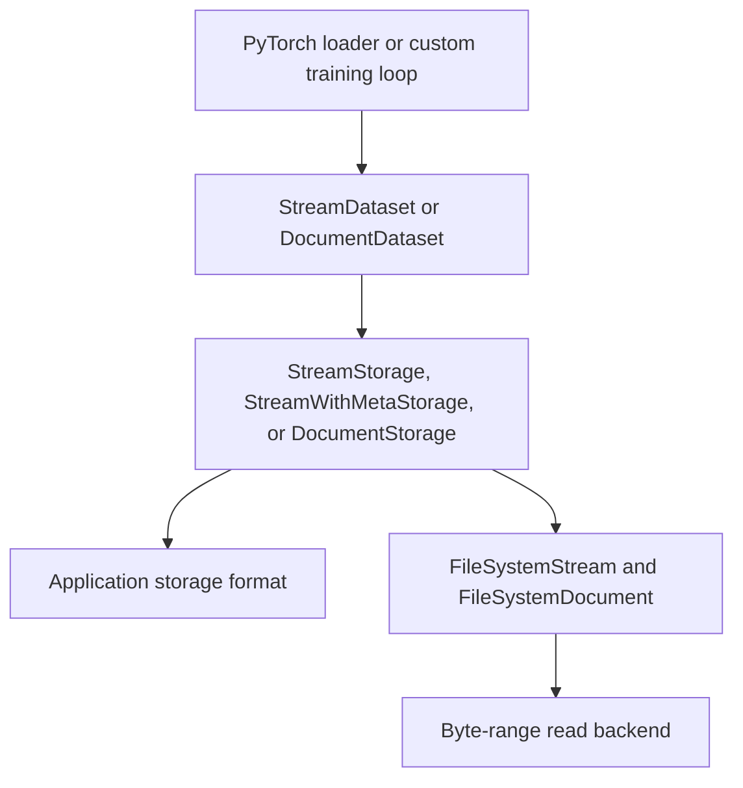

# The dataset API

`StatefulDataLoader.from_storage` is the usual way to read into PyTorch. It wraps
storage in `StreamDataset` or `DocumentDataset` for you. Use those views directly
when you need indexed access for inspection, a custom training loop, or a
framework other than PyTorch.

Dataset views translate sample indices into storage reads. Use
`StreamDataset(storage, sequence_length=...)` with either stream storage type.
Use `DocumentDataset(storage)` with document storage. Open a reader before calling
`len(reader)` or indexing it; close it when done.

```python
from pathlib import Path
from tempfile import TemporaryDirectory

from guideloom import DocumentDataset, DocumentPickleFormat, DocumentStorage

with TemporaryDirectory() as directory:
    storage = DocumentStorage(Path(directory), DocumentPickleFormat())
    with storage.sync_writer() as writer:
        for value in range(6):
            writer.append(0, value)
    dataset = DocumentDataset(storage)
    with dataset.sync_reader() as reader:
        assert len(reader) == 6
        assert reader[2] == 2
        assert list(reader[1:4]) == [1, 2, 3]
```

A direct reader returns the format's decoded objects in index order. It does not
shuffle, batch, or track training progress. Stream indices select complete,
non-overlapping windows; changing `sequence_length` changes that dataset view.
Use storage readers directly when you need arbitrary ranges rather than fixed
sample windows.



Storage and dataset objects describe access. Reader context managers own open
resources. This composition lets you change the training framework or byte-read
backend without changing the stored application schema. For a custom training
loop with batching and partitioning, see [other frameworks](other-frameworks.md).
